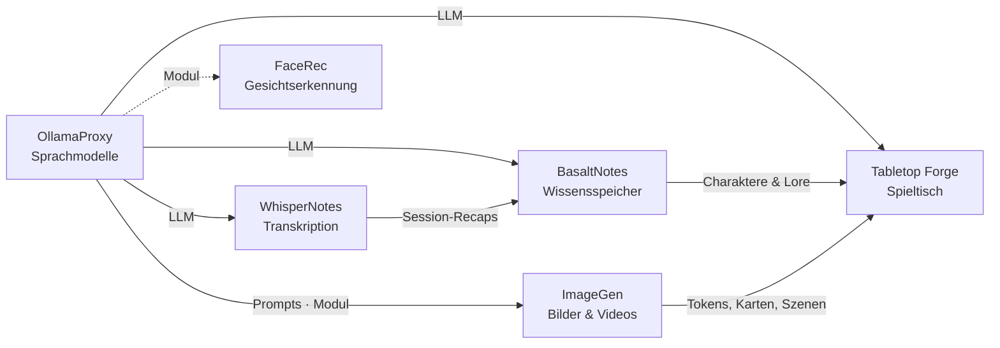

# ImageGen

🇬🇧 [English](README.md) · 🇩🇪 Deutsch

> Bilder und Videos auf der eigenen GPU: ComfyUI mit fertigen Workflows, eine handytaugliche Web-App mit Benutzern
> und eine API – der Bildgenerator der Poldion-Familie.

**Lizenz:** MIT (Web-App, Workflows), GPL-3.0 (ComfyUI-Erweiterungen) · **Sprache:** Python (FastAPI), Vanilla JS ·
**Läuft auf:** Linux mit AMD-GPU (ROCm, getestet auf Ryzen AI Max / gfx1151) · **Teil von:** [Poldion Self-Hosted](#die-poldion-familie)


## Überblick

| Teil | Port | Aufgabe |
|---|---|---|
| **ComfyUI** (`comfyui/`) | 8188 | Rechnet auf der GPU. Eigenes Image auf Basis von `rocm/pytorch`, ohne Login – nur im LAN |
| **Workflows** (`workflows/`) | – | Werden per Skript erzeugt (`build_workflows.py`), als UI- und API-Format, erweiterbar über `extras/` |
| **Web-App** (`webapp/`) | 8190 | Oberfläche fürs Handy mit Benutzern, Verlauf, Serien und API-Schlüsseln |

## Funktionen

| Bereich | Was es kann |
|---|---|
| **Workflows** | Anime, Realistisch, Gezeichnet im D&D-Stil, Bearbeiten, gleiche Figur in neuer Szene, FLUX 3 Klein, Text-zu-Video und Bild-zu-Video (Wan 2.2) |
| **D&D** | Eigener Tab: Illustration, Ort, runder Token (PNG mit Transparenz, auch „Token aus Bild“), Battlemap und Ortskarte im VTT-Stil |
| **Ausformulieren** | Kurze Idee → ausführlicher englischer Prompt über ein Sprachmodell (z. B. den [OllamaProxy](https://github.com/Poldion/OllamaProxy)), mit Regeln je Workflow |
| **Variablen & Serien** | `[rot\|blau]` und benannte, verschachtelte Variablen; Serien beliebiger Länge, gleichmäßig gewürfelt, abbrechbar |
| **Bild als Eingabe** | Mehrere Bilder auf einmal mit demselben Prompt bearbeiten oder animieren |
| **Videos** | Länge, Bewegungsstärke in 5 Stufen, Format passend zum Startbild |
| **Benutzer** | Einrichtungsassistent, Admin und Benutzer, jeder sieht nur eigene Bilder, NSFW-Freigabe je Benutzer, ZIP-Download. Oberfläche auf Deutsch und Englisch |
| **API** | Schlüssel je Benutzer: eigene API (`/api/v1/*`) und OpenAI-kompatibel (`/v1/images/generations`, `/v1/images/edits`) – z. B. für Open WebUI |
| **Erweiterungen** | Eigene Workflows, Auswahlen und LoRAs als `extras/*.py`, ohne den Code zu ändern |
| **Speicher** | Erweiterung `proxy_memory` gibt den RAM von ComfyUI auf Unified-Memory-Systemen wirklich frei; als Modul des OllamaProxy wird ComfyUI nach Leerlauf freigegeben |

## Schnellstart

Voraussetzung: Linux mit AMD-GPU (ROCm-fähig), Docker mit Compose, Gruppen `video`/`render`.

```bash
git clone https://github.com/Poldion/ImageGen.git && cd ImageGen
mkdir -p ~/imagegen/{models,output,input,custom_nodes,extras,comfy-user,webapp-data,cache}
cp imagegen.env.example ~/imagegen/imagegen.env      # IMAGEGEN_DATA, PUID/PGID, GPU-Gruppen anpassen
docker compose --env-file ~/imagegen/imagegen.env up -d --build
```

Danach `http://<host>:8190/` öffnen und im Assistenten das Admin-Konto anlegen. ComfyUI selbst läuft unter
`http://<host>:8188/`. Die **Modelle** lädst du selbst nach `~/imagegen/models/` – welche Datei in welchen Ordner
gehört und woher sie kommt, steht in [MODELLE.md](MODELLE.md). Für das Workflow-Menü in ComfyUI die Dateien
`workflows/*.json` nach `~/imagegen/comfy-user/default/workflows/` kopieren.

## Konfiguration

| Variable | Standard | Bedeutung |
|---|---|---|
| `IMAGEGEN_DATA` | `~/imagegen` | Datenordner (Modelle, Ausgaben, Datenbank, Erweiterungen) |
| `WEBAPP_PORT` / `COMFYUI_PORT` | `8190` / `8188` | Ports |
| `WEBAPP_LLM_URL` / `WEBAPP_LLM_MODEL` | – | Ollama-kompatibles Sprachmodell für „Ausformulieren“; leer = Funktion aus |
| `WEBAPP_TRUSTED_PROXIES` | private Netze | Nur diesen Proxys wird `X-Forwarded-For` geglaubt |
| `WEBAPP_MAX_BATCH` / `WEBAPP_MAX_ACTIVE_JOBS` | `1000` / `2000` | Schutz gegen Tippfehler bei Serien |
| `WEBAPP_SESSION_DAYS` | `30` | Gültigkeit einer Anmeldung |
| `WEBAPP_IDLE_FREE_MINUTES` | `2` | Als Modul des OllamaProxy: ComfyUI nach so viel Leerlauf freigeben (`0` = nie) |
| `WEBAPP_MODULE_TOKEN` | – | Optionaler Schlüssel für die Modul-Schnittstelle |

**Sicherheit:** ComfyUI hat keine Anmeldung und gehört nur ins LAN. Die Web-App hat Login-Sperre, Origin-Prüfung und
Schutz gegen Einbetten. Ins Internet nur hinter einem Reverse-Proxy mit HTTPS.

## Erweiterungen

`workflows/extras/*.py` bzw. `${IMAGEGEN_DATA}/extras/*.py` werden beim Bauen der Workflows geladen und dürfen
Workflows, Auswahlen („Bewegung“, „Aktion“) und LoRAs ergänzen. Die Web-App baut ihre Workflows bei jedem Start neu,
eine neue Erweiterung wirkt also nach `docker compose ... restart webapp`. Beispiel und Schnittstelle:
[workflows/extras/README.md](workflows/extras/README.md). Optionen mit `"nsfw": true` sehen nur Benutzer mit
NSFW-Freigabe.

## Zusammenspiel mit der Poldion-Familie

- **[OllamaProxy](https://github.com/Poldion/OllamaProxy)** liefert das Sprachmodell für „Ausformulieren“ und bindet
  ImageGen als Modul ein (Eintrag in seiner `modules.json`: `{"url": "http://host.docker.internal:8190"}`):
  Speicheranzeige, Links und Freigabe nach Leerlauf.
- **[Tabletop Forge](https://github.com/Poldion/TabletopForge)** erzeugt über die API Tokens, Porträts, Battlemaps,
  Ortskarten und Szenenbilder. Dafür legst du in der Web-App einen Schlüssel (`ig_…`) an.
- **Open WebUI** und andere OpenAI-Clients nutzen `http://<host>:8190/v1` als Bild-API.

## Die Poldion-Familie

Sechs selbst gehostete Projekte, die einzeln funktionieren und zusammen ein Ganzes ergeben:



| Projekt | Rolle |
|---|---|
| [OllamaProxy](https://github.com/Poldion/OllamaProxy) | KI-Zentrale: Sprachmodelle mit festen Einstellungen, Module für weitere Dienste |
| **ImageGen** (dieses Repository) | Bilder und Videos mit ComfyUI, Web-App und API |
| [FaceRec](https://github.com/Poldion/FaceRec) | Gesichtserkennung an der Türklingel für Home Assistant |
| [WhisperNotes](https://github.com/Poldion/WhisperNotes) | Transkription, Sprechererkennung, Zusammenfassungen und D&D-Recaps |
| [BasaltNotes](https://github.com/Poldion/BasaltNotes) | Notizen und Welt-Wiki mit KI-Kurator |
| [Tabletop Forge](https://github.com/Poldion/TabletopForge) | Digitaler Spieltisch und Kampagnenverwaltung für 5e |

## Dokumentation

- [MODELLE.md](MODELLE.md) – welche Modelle, wohin, woher, unter welcher Lizenz (Englisch: [MODELS.md](MODELS.md))
- [docs/technik.md](docs/technik.md) – Aufbau, Workflows im Detail, Messwerte, Web-App, API, Sicherheit (Englisch: [technik.en.md](docs/technik.en.md))
- [workflows/extras/README.md](workflows/extras/README.md) – eigene Erweiterungen schreiben (Englisch: [README.en.md](workflows/extras/README.en.md))
- [CHANGELOG.md](CHANGELOG.md) – Versionsverlauf (nur Englisch)
- [CONTRIBUTING.md](CONTRIBUTING.md) – Entwicklungsumgebung, Tests, Regeln (nur Englisch, mit deutschem Abschnitt)
- [SECURITY.md](SECURITY.md) – Sicherheitslücken melden (nur Englisch)

## Entwicklung

```bash
webapp/run_tests.sh                                           # Tests im Container gegen ein nachgebautes ComfyUI
python3 workflows/build_workflows.py http://127.0.0.1:8188 workflows   # Workflows neu erzeugen (prüft gegen ComfyUI)
python3 workflows/run_workflow.py workflows/api/<name>.json "Prompt"
```

## Lizenz & Drittanbieter

Web-App, Workflows und Skripte: [MIT](LICENSE). Die Erweiterungen unter `comfyui/custom_nodes/` stehen unter der
[GPL-3.0](comfyui/custom_nodes/LICENSE), weil sie ComfyUI (GPL-3.0) erweitern. **Modelle werden nicht mitgeliefert;
mehrere haben nicht-kommerzielle Lizenzen** (z. B. Qwen-Image 2.1 unter der Qwen-Research-Lizenz), LoRAs von Civitai
eigene Bedingungen. Übersicht: [THIRD_PARTY_NOTICES.md](THIRD_PARTY_NOTICES.md). Die Modelle filtern Inhalte nicht;
Optionen für Inhalte ab 18 sieht nur, wem der Admin das freigibt. D&D ist eine Marke von Wizards of the Coast; dieses
Projekt ist inoffiziell und nicht mit Wizards of the Coast verbunden.

## Unterstützen

Wenn dir das Projekt hilft, freue ich mich über Rückmeldungen, Fehlerberichte und Pull Requests – siehe
[CONTRIBUTING.md](CONTRIBUTING.md).
Ein Spenden-Link folgt. <!-- SPENDEN_LINK -->
