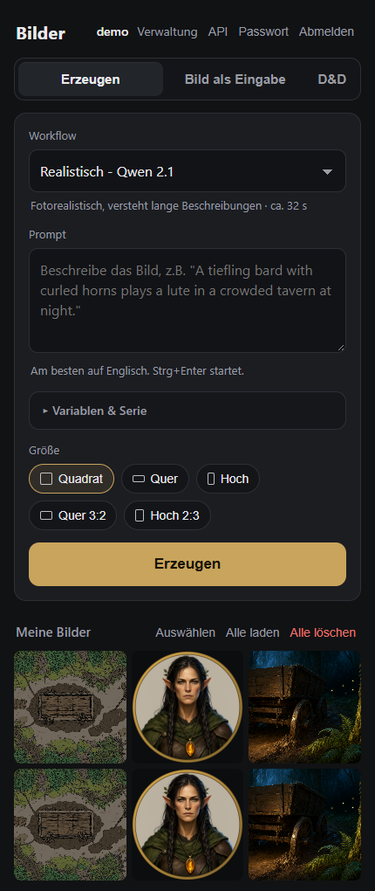
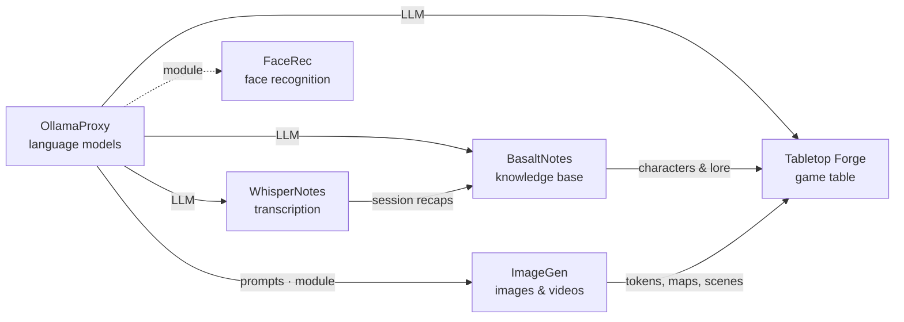

# ImageGen

🇬🇧 English · 🇩🇪 [Deutsch](README.de.md)

> Images and videos on your own GPU: ComfyUI with ready-made workflows, a phone-friendly web app with users and an
> API – the image generator of the Poldion family.

**License:** MIT (web app, workflows), GPL-3.0 (ComfyUI extensions) · **Language:** Python (FastAPI), vanilla JS ·
**Runs on:** Linux with AMD GPU (ROCm, tested on Ryzen AI Max / gfx1151) · **Part of:** [Poldion Self-Hosted](#the-poldion-family)



## Overview

| Part | Port | Job |
|---|---|---|
| **ComfyUI** (`comfyui/`) | 8188 | Does the GPU work. Own image based on `rocm/pytorch`, no login – LAN only |
| **Workflows** (`workflows/`) | – | Generated by a script (`build_workflows.py`) in UI and API format, extensible via `extras/` |
| **Web app** (`webapp/`) | 8190 | Phone-friendly UI with users, history, series and API keys |

## Features

| Area | What it does |
|---|---|
| **Workflows** | Anime, realistic, painted in D&D style, editing, same character in a new scene, FLUX 3 Klein, text-to-video and image-to-video (Wan 2.2) |
| **D&D** | Own tab: illustration, location, round token (PNG with transparency, also "token from image"), battle map and town map in VTT style |
| **Prompt expansion** | Short idea → detailed English prompt via a language model (e.g. [OllamaProxy](https://github.com/Poldion/OllamaProxy)), with rules per workflow |
| **Variables & series** | `[red\|blue]` and named, nested variables; series of any length, evenly randomized, cancelable |
| **Image as input** | Edit or animate several images at once with the same prompt |
| **Videos** | Length, motion strength in 5 levels, format matching the start image |
| **Users** | Setup wizard, admin and users, everyone sees only their own images, NSFW permission per user, ZIP download. UI in English and German |
| **API** | Keys per user: own API (`/api/v1/*`) and OpenAI-compatible (`/v1/images/generations`, `/v1/images/edits`) – e.g. for Open WebUI |
| **Extensions** | Own workflows, options and LoRAs as `extras/*.py`, without changing the code |
| **Memory** | The `proxy_memory` extension really frees ComfyUI's RAM on unified-memory systems; as an OllamaProxy module ComfyUI is freed after idle time |

## Quick start

Requirements: Linux with an AMD GPU (ROCm capable), Docker with Compose, groups `video`/`render`.

```bash
git clone https://github.com/Poldion/ImageGen.git && cd ImageGen
mkdir -p ~/imagegen/{models,output,input,custom_nodes,extras,comfy-user,webapp-data,cache}
cp imagegen.env.example ~/imagegen/imagegen.env      # adjust IMAGEGEN_DATA, PUID/PGID, GPU groups
docker compose --env-file ~/imagegen/imagegen.env up -d --build
```

Then open `http://<host>:8190/` and create the admin account in the wizard. ComfyUI itself runs at
`http://<host>:8188/`. Download the **models** yourself into `~/imagegen/models/` – which file goes into which folder
and where it comes from is listed in [MODELS.md](MODELS.md). For the workflow menu in ComfyUI, copy
`workflows/*.json` to `~/imagegen/comfy-user/default/workflows/`.

## Configuration

| Variable | Default | Meaning |
|---|---|---|
| `IMAGEGEN_DATA` | `~/imagegen` | Data folder (models, outputs, database, extensions) |
| `WEBAPP_PORT` / `COMFYUI_PORT` | `8190` / `8188` | Ports |
| `WEBAPP_LLM_URL` / `WEBAPP_LLM_MODEL` | – | Ollama-compatible language model for prompt expansion; empty = feature off |
| `WEBAPP_TRUSTED_PROXIES` | private networks | Only these proxies are trusted for `X-Forwarded-For` |
| `WEBAPP_MAX_BATCH` / `WEBAPP_MAX_ACTIVE_JOBS` | `1000` / `2000` | Guard against typos in series |
| `WEBAPP_SESSION_DAYS` | `30` | How long a login stays valid |
| `WEBAPP_IDLE_FREE_MINUTES` | `2` | As an OllamaProxy module: free ComfyUI after this much idle time (`0` = never) |
| `WEBAPP_MODULE_TOKEN` | – | Optional key for the module interface |

**Security:** ComfyUI has no login and belongs in the LAN only. The web app has login throttling, origin checks and
framing protection. Expose it to the internet only behind a reverse proxy with HTTPS.

## Extensions

`workflows/extras/*.py` or `${IMAGEGEN_DATA}/extras/*.py` are loaded when the workflows are built and may add
workflows, options ("Bewegung" = motion, "Aktion" = action) and LoRAs. The web app rebuilds its workflows on every
start, so a new extension takes effect after `docker compose ... restart webapp`. Example and interface:
[workflows/extras/README.md](workflows/extras/README.md) (German). Options with `"nsfw": true` are only shown to
users with NSFW permission.

## Working with the Poldion family

- **[OllamaProxy](https://github.com/Poldion/OllamaProxy)** provides the language model for prompt expansion and
  includes ImageGen as a module (entry in its `modules.json`: `{"url": "http://host.docker.internal:8190"}`): memory
  view, links and freeing after idle time.
- **[Tabletop Forge](https://github.com/Poldion/TabletopForge)** creates tokens, portraits, battle maps, town maps and
  scene images through the API. Create a key (`ig_…`) in the web app for it.
- **Open WebUI** and other OpenAI clients use `http://<host>:8190/v1` as an image API.

## The Poldion family

Six self-hosted projects that work on their own and form a whole together:



| Project | Role |
|---|---|
| [OllamaProxy](https://github.com/Poldion/OllamaProxy) | AI hub: language models with fixed settings, modules for other services |
| **ImageGen** (this repository) | Images and videos with ComfyUI, web app and API |
| [FaceRec](https://github.com/Poldion/FaceRec) | Face recognition at the doorbell for Home Assistant |
| [WhisperNotes](https://github.com/Poldion/WhisperNotes) | Transcription, speaker detection, summaries and D&D recaps |
| [BasaltNotes](https://github.com/Poldion/BasaltNotes) | Notes and world wiki with an AI curator |
| [Tabletop Forge](https://github.com/Poldion/TabletopForge) | Digital game table and campaign management for 5e |

## Documentation

- [MODELS.md](MODELS.md) – which models, where to put them, where to get them, which license (German: [MODELLE.md](MODELLE.md))
- [docs/technik.en.md](docs/technik.en.md) – architecture, workflows in detail, measurements, web app, API, security (German: [technik.md](docs/technik.md))
- [workflows/extras/README.en.md](workflows/extras/README.en.md) – writing your own extensions (German: [README.md](workflows/extras/README.md))
- [CHANGELOG.md](CHANGELOG.md) – version history
- [CONTRIBUTING.md](CONTRIBUTING.md) – development setup, tests, guidelines, translations
- [SECURITY.md](SECURITY.md) – reporting security issues

## Development

```bash
webapp/run_tests.sh                                           # tests in a container against a simulated ComfyUI
python3 workflows/build_workflows.py http://127.0.0.1:8188 workflows   # regenerate workflows (checked against ComfyUI)
python3 workflows/run_workflow.py workflows/api/<name>.json "Prompt"
```

## License & third parties

Web app, workflows and scripts: [MIT](LICENSE). The extensions under `comfyui/custom_nodes/` are licensed under
[GPL-3.0](comfyui/custom_nodes/LICENSE) because they extend ComfyUI (GPL-3.0). **No models are included; several of
them have non-commercial licenses** (e.g. Qwen-Image 2.1 under the Qwen Research License), LoRAs from Civitai have
their own terms. Overview: [THIRD_PARTY_NOTICES.md](THIRD_PARTY_NOTICES.md). The models do not filter content; options
for adult content are only shown to users the admin has enabled. D&D is a trademark of Wizards of the Coast; this
project is unofficial and not affiliated with Wizards of the Coast.

## Support

If the project helps you, I'm happy about feedback, bug reports and pull requests – see [CONTRIBUTING.md](CONTRIBUTING.md).
A donation link will follow. <!-- SPENDEN_LINK -->
